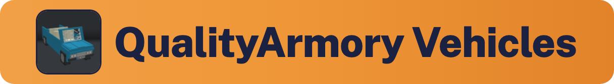

<div align="center">



[](https://www.spigotmc.org/resources/qualityarmory-vehicles-2.59129/)
[](https://www.spigotmc.org/resources/qualityarmory-vehicles-2.59129/updates)
[](LICENSE)

**Cars, planes, boats, helicopters and more for Minecraft servers, with custom 3D models**

</div>

---

## ✨ Features

### 🚗 Vehicles

- **Cars** - Drivable cars with fuel, health and adjustable speed
- **Planes & Helicopters** - Take off, fly and land
- **Boats** - Vehicles built for the water
- **Trains & Trams** - Rail vehicles that run on configurable tram/underground tracks
- **Tractors & Drills** - Utility vehicles
- **Horse-drawn Carriages** - Hitch horses to carriages by hand
- **Custom Models** - 3D vehicle models through the resource pack, with ModelEngine support

### 🛠️ Gameplay

- **Fuel & Repair** - Register fuel items and repair damaged vehicles
- **Garage** - Store vehicles and call them back with `/garage`
- **Passenger Seats** - Configurable seats, seat sizes and passenger whitelists
- **Accurate Hitboxes** - Click anywhere on a vehicle to enter it, or click a seat to sit there
- **Shop & Crafting** - Buy or craft vehicles from in-game menus
- **Vehicle Limits** - Cap the number of vehicles per player with permissions
- **Multi-Version Support** - Runs on Minecraft 1.9 up to the latest releases

### 🔌 Plugin Integrations

- **Protection**: WorldGuard, Towny
- **Economy**: Vault, QuickShop
- **Models**: ModelEngine
- **Utilities**: QualityArmory, ViaVersion

---

## 📥 Download

[](https://www.spigotmc.org/resources/qualityarmory-vehicles-2.59129/)

---

## 🚀 Quick Start

1. **Download** QualityArmoryVehicles from Spigot
2. **Install** [ProtocolLib](https://www.spigotmc.org/resources/protocollib.1997/) (required)
3. **Place** both jars in your server's `plugins` folder
4. **Start** your server
5. **Configure** vehicles, fuel and shops in the generated config files

### Optional Enhancements

- **QualityArmory** - Shared resource pack and gun integration
- **ModelEngine** - Animated vehicle models
- **Vault** - Economy for the vehicle shop
- **WorldGuard / Towny** - Control where vehicles can be used
- **ViaVersion** - Cross-version compatibility

---

## 👨‍💻 For Developers

### Building

The project uses Gradle and targets Java 8:

```bash
./gradlew build
```

The shaded jar is written to `build/libs/`.

### API

The API lives in the `me.zombie_striker.qav.api` package. `QualityArmoryVehicles` is the entry point, and the
`api.events` package has Bukkit events you can listen to:

- `VehicleSpawnEvent`, `VehicleDestroyEvent`, `VehicleDamageEvent`, `VehicleRepairEvent`
- `PlayerEnterQAVehicleEvent`, `PlayerExitQAVehicleEvent`
- `VehicleChangeSpeedEvent`, `VehicleTurnEvent`
- `VehicleHitchEvent`, `VehicleUnhitchEvent`

---

## 🎮 Commands & Permissions

### Main Commands

- `/qav` or `/qualityarmoryvehicles` - Main command
- `/qav give <vehicle> [player]` - Give a vehicle to yourself or a player
- `/qav spawnVehicle <vehicle>` - Spawn a vehicle where you stand
- `/qav shop` - Open the vehicle shop
- `/qav callback` - Call your vehicle back
- `/qav tracks` - Set up tram/underground tracks
- `/qav reload` - Reload the configuration
- `/qav hitbox` - Show the vehicle hitboxes and seats
- `/garage` - Open your garage

### Key Permissions

- `qualityarmoryvehicles.*` - All permissions
- `qualityarmoryvehicles.admin` - Admin commands
- `qualityarmoryvehicles.default` - Default player permissions (given to everyone)
- `qualityarmoryvehicles.use` - Drive vehicles
- `qualityarmoryvehicles.shop` - Open the shop
- `qualityarmoryvehicles.craft` - Craft vehicles
- `qualityarmoryvehicles.garage` - Use the garage
- `qualityarmoryvehicles.vehiclelimit.<n>` - Own up to `<n>` vehicles

The full list is in [`plugin.yml`](src/main/resources/plugin.yml).

---

## 🤝 Contributing

Contributions are welcome! Feel free to:

- Report bugs
- Suggest features
- Submit pull requests

---

## 👥 Authors

- **Zombie_Striker** - Original Creator
- **Lorenzo0111** - Maintainer

---

## 📄 License

See the [LICENSE](LICENSE) file for details.

---

## 🔗 Links

- [Spigot Resource Page](https://www.spigotmc.org/resources/qualityarmory-vehicles-2.59129/)
- [QualityArmory](https://github.com/ZombieStriker/QualityArmory)
